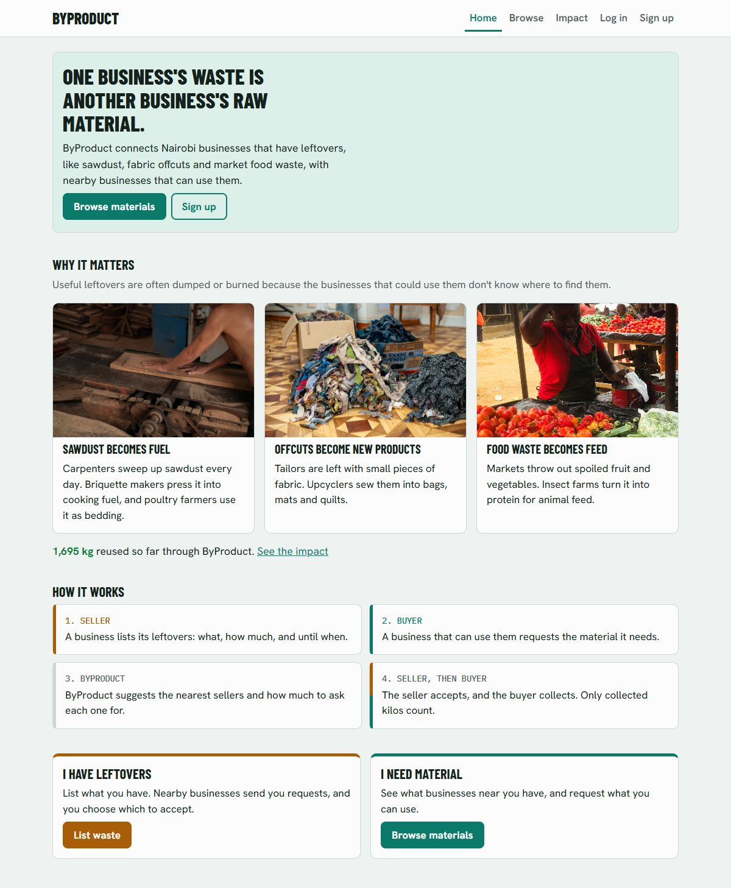
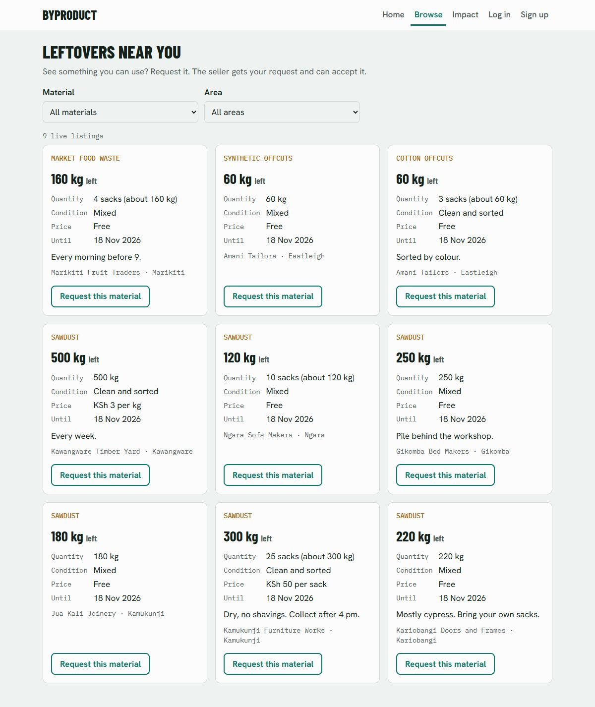
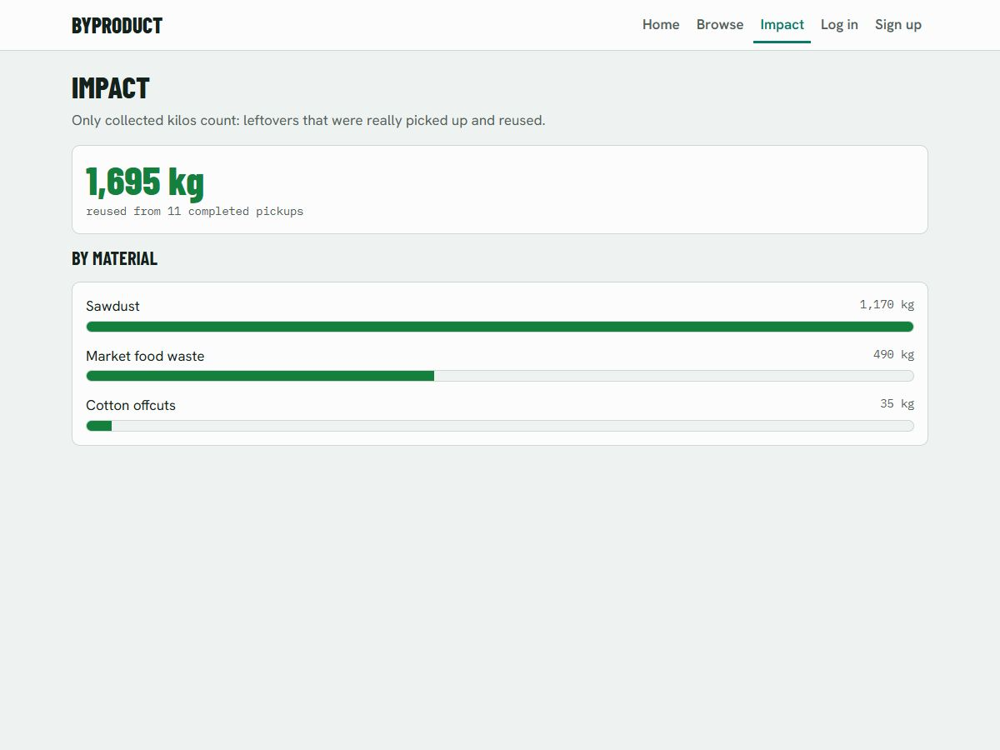

# ByProduct (frontend)

**One business's waste is another business's raw material.**

Small Nairobi businesses that make products from other businesses' leftovers can't easily find enough of them. Briquette makers need sawdust, upcyclers need fabric offcuts, and insect farms need food waste. ByProduct lets businesses list their leftovers and request the material they need. For each request, it suggests the nearest sellers and how much to ask each one for, then tracks every pickup until the buyer confirms it was collected. Only collected kilos count as **kilos reused**.

This is the React app. It talks to the [ByProduct API](https://github.com/lalettywambo/ByProduct), a Django REST API.

- **Live site:** <https://byproduct-frontend.vercel.app>
- **API documentation (Swagger):** <https://byproduct-api.onrender.com/api/docs/>

## Screenshots

| Home | Browse | Impact |
|---|---|---|
|  |  |  |

## Features

- **Home page** that explains what ByProduct does, why it matters and how it works, with the live total of kilos reused.
- **Browse** live listings, filter them by material and area, and load more as the list grows (the API sends 20 at a time).
- **Sign up and log in** as a business. One login can both sell and buy.
- **Sellers** list leftovers (in kg or sacks, free or priced), edit, withdraw, relist or delete them, and accept or decline requests.
- **Buyers** request material: ByProduct suggests the nearest sellers within 5, 10 or 20 km and how much to ask each one for. Ask one seller or all of them at once, then mark pickups as collected.
- **Dashboard** with requests waiting for your answer, agreed pickups (with the other side's phone number), your listings and your open needs. It and the need page check for changes every 10 seconds while the tab is open, so the other business's answers show up without a reload.
- **Impact** page: total kilos reused and kilos by material.
- Built for cheap phones: works at 360px wide, every button at least 44px tall, and it follows the phone's dark mode.

## Tech stack

- React 19 and Vite 8, plain JavaScript (no TypeScript)
- `react-router` 7.18.5 for pages, the only extra package the app uses
- `fetch` for API calls, plain CSS, `useState`/`useEffect`, and one React context for the login
- ESLint (the Vite template's setup) and Vitest 5.1.0 for tests

## Run it

You need Node 22.12 or newer.

```powershell
npm install
```

Create a file called `.env.local` in this folder with the API's address (copy `.env.example`):

```
VITE_API_URL=https://byproduct-api.onrender.com/api
```

`.env.local` is git-ignored. To use a backend running on your laptop instead, set `VITE_API_URL=http://127.0.0.1:8000/api` (the backend must allow `http://localhost:5173` in `CORS_ALLOWED_ORIGINS`).

```powershell
npm run dev      # start the app at http://localhost:5173
```

The API runs on Render's free plan, which sleeps when nobody uses it. The first request can take up to a minute, and the app says so while it loads.

**Demo logins** (made by the backend's `seed_demo` command; the password is the backend's `DEMO_PASSWORD`): `moto` is a briquette maker who needs sawdust; `doors`, `kamukunji`, `joinery`, `bedmakers` and `sofas` are carpenters within 10 km; `timber` is 14.5 km away.

## Test it

```powershell
npm run lint     # check the code with ESLint
npm test         # run the tests once with Vitest
npm run build    # build the finished site into dist/
```

The tests cover the app's core functions: formatting kilos, prices, quantities, distances and dates, working out a listing's status, and turning API errors into readable messages (`src/helpers.test.js` and `src/api.test.js`).

## Pages

| Address | Who | What |
|---|---|---|
| `/` | everyone | Home: what ByProduct is, why it matters, how it works |
| `/browse` | everyone | Live listings, filter by material and area, "Load more" |
| `/impact` | everyone | Total kilos reused and kilos by material |
| `/login`, `/sign-up` | everyone | Log in, or sign up a business |
| `/dashboard` | logged in | Requests to answer, agreed pickups, my listings, my open needs |
| `/listings/new`, `/listings/:id/edit` | logged in | List leftovers, or edit a listing |
| `/needs/new`, `/needs/:id/edit` | logged in | Request material, or edit a need |
| `/needs/:id` | logged in, the buyer | Progress, suggested sellers, ask one or all, my requests |
| `/profile` | logged in | Edit my business, log out, delete my account |

Anything else shows a "Page not found" page.

## Folder layout

```
public/favicon.svg        the tab icon
index.html                the page shell, with the Google Fonts links
docs/screenshots/         the screenshots in this README
src/
  main.jsx                starts React inside BrowserRouter and AuthProvider
  App.jsx                 the list of routes (address -> page)
  api.js                  every API request goes through api() here; also the login tokens
  AuthContext.jsx         who is logged in: login, register, logout, delete account
  useApi.js               a hook that loads data for a page: { data, error, loading, reload }
  usePolling.js           a hook that calls reload() every 10 seconds while the tab is visible
  helpers.js              formatting (kg, price, dates, distance) and form-error helpers
  *.test.js               tests for helpers.js and api.js
  index.css               the design: colour tokens (with dark mode), layout, cards, buttons
  assets/                 the three photos on the home page
  components/             pieces used by several pages
    Layout.jsx            header and nav around every page
    RequireAuth.jsx       sends logged-out visitors to /login and back
    ListingCard.jsx       one listing as a card
    PickupRow.jsx         one pickup with the buttons the viewer may press
    ProgressBar.jsx       a need's stacked bar: collected, agreed, waiting
    StatusPill.jsx        the coloured status of a pickup
    ActionButton.jsx      a button that calls the API and shows its result or error
    Notice.jsx            the short message after an action
    ErrorList.jsx, FieldError.jsx, BusinessFields.jsx
  pages/                  one file per screen
```

## How login works

- **Logging in or signing up** gives the app two tokens from the API: a short **access token** (30 minutes) and a long **refresh token** (7 days).
- **The access token** is kept only in memory, never saved in the browser. The app sends it with every request to prove who is asking.
- **The refresh token** is saved in the browser's `localStorage`, so reloading the page keeps you logged in: on start-up the app uses it to get a new access token and asks the API which business is logged in.
- **When the access token runs out**, the API refuses the request. The app swaps the refresh token for a new pair of tokens **once** and tries the request again. The old refresh token stops working, so the new one is saved straight away. If several requests fail at the same moment, they all wait for that one swap instead of each starting their own.
- **If the refresh token has run out too** (after 7 days, or after logging out elsewhere), the app forgets the login. Public pages like Browse keep working.
- **Logging out** tells the API to block the refresh token, then the app forgets both tokens.

Pages that need a login are wrapped in `<RequireAuth>`, which sends logged-out visitors to the login page and back to the page they wanted afterwards.

## Deployment

The site is hosted on **Vercel**, which builds it with `npm run build` on every push to `main`.

- Set **`VITE_API_URL`** = `https://byproduct-api.onrender.com/api` in Vercel's **Settings → Environment Variables**. Vite writes it into the JavaScript at build time, so after changing it you must **redeploy**.
- `vercel.json` sends every address to `index.html`, so links like `/dashboard` work when the page is reloaded.
- The API must list the site's address (`https://byproduct-frontend.vercel.app`) in its `CORS_ALLOWED_ORIGINS`.

## Design

The colours, fonts and rules match the ByProduct concept page: buyer things are teal, seller things are amber; status pills are amber (waiting), teal (agreed), green (collected) and red (declined or cancelled).

## Photo credits

The photos on the home page are free to use under the [Pexels licence](https://www.pexels.com/license/):

- Carpenter at a planing machine: [Pew Nguyen on Pexels](https://www.pexels.com/photo/carpenter-working-with-wood-in-workshop-37162562/)
- Fabric scraps: [Alexander Zvir on Pexels](https://www.pexels.com/photo/shredded-clothes-in-boxes-and-on-the-floor-11496275/)
- Vegetable market: [Fireworks Uche on Pexels](https://www.pexels.com/photo/woman-selling-vegetables-on-a-food-market-20432829/)

## Author

Built by [lalettywambo](https://github.com/lalettywambo) as a capstone project for Zindua School.
